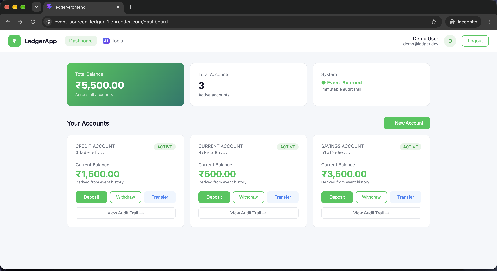
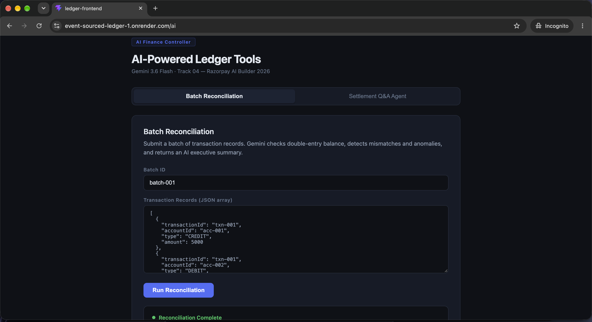
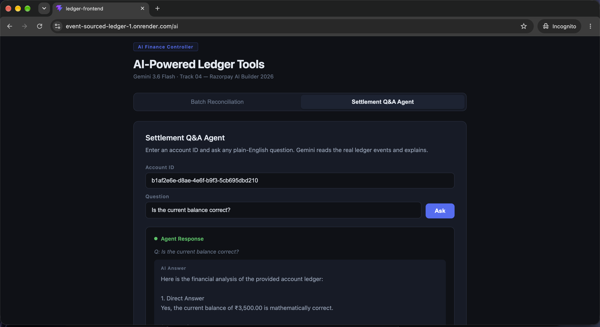
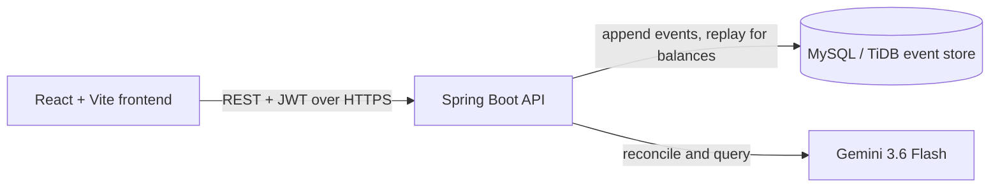

# Event-Sourced Payment Ledger

A fintech-style payment ledger built with **Spring Boot** and **React**. Nothing is ever edited in place: every deposit, withdrawal and transfer is stored as an immutable event, and balances are derived by replaying that history. Transfers are recorded as matching debit and credit entries (double-entry bookkeeping), and an AI finance controller powered by Gemini reconciles batches and answers questions about settlements.

## Live demo

| | |
|---|---|
| App | https://event-sourced-ledger-1.onrender.com |
| API | https://event-sourced-ledger-x2r4.onrender.com |





> The backend runs on a free tier and sleeps when idle, so the **first request can take up to a minute** while it wakes up. After that it responds normally.

### Demo login

| | |
|---|---|
| Email | `demo@ledger.dev` |
| Password | `Demo@12345` |

> This is a shared demo account, so other visitors may change its balances. Prefer your own sandbox? Register a new account on the login page, it takes a few seconds.

### What to try

1. **Move money.** Open the demo account, deposit some money, then transfer between the two accounts. The total across accounts never changes on a transfer.
2. **Read the audit trail.** Click **View Audit Trail** on an account to see the immutable events behind its balance.
3. **Run the AI controller.** Go to **Tools**, open **Batch Reconciliation** and click **Run Reconciliation** on the sample batch. Gemini checks double-entry balance, flags anomalies and writes a summary.
4. **Ask a question.** Switch to the **Settlement Q&A Agent** tab and ask about settlements in plain language.

## Why event sourcing?

- **Audit trail for free.** Every change is an append-only event, so you can always see how a balance came to be.
- **Balances are derived, not stored.** The current balance is computed from event history, which removes a whole class of "the number drifted" bugs.
- **Double-entry.** A transfer posts a debit on one account and a credit on the other, so totals always reconcile.

## Features

- JWT authentication (register and login)
- Multiple accounts per user (savings, credit)
- Deposit, withdraw and transfer between accounts
- Per-account event history and statements
- **AI Finance Controller** (Gemini 3.6 Flash):
  - **Batch reconciliation**: submit transaction records, check double-entry balance, detect mismatches and anomalies, get an executive summary
  - **Settlement Q&A agent**: ask questions about settlements in plain language

## Architecture



## Tech stack

| Layer | Technology |
|---|---|
| Backend | Java 21, Spring Boot 3.5, Spring Security, Spring Data JPA |
| Database | MySQL (TiDB Cloud in production) |
| Auth | JWT |
| AI | Google Gemini 3.6 Flash |
| Frontend | React 19, Vite, React Router, Axios |
| Deploy | Docker, Render (web service and static site) |

## API overview

| Method | Endpoint | Purpose |
|---|---|---|
| POST | `/api/auth/register` | Create a user and return a JWT |
| POST | `/api/auth/login` | Log in and return a JWT |
| POST | `/api/accounts` | Open an account |
| GET | `/api/accounts` | List your accounts |
| GET | `/api/accounts/{id}` | Account details |
| GET | `/api/accounts/{id}/balance` | Balance derived from events |
| GET | `/api/accounts/{id}/events` | Raw event history |
| GET | `/api/accounts/{id}/statement` | Account statement |
| POST | `/api/transactions/deposit` | Deposit |
| POST | `/api/transactions/withdraw` | Withdraw |
| POST | `/api/transactions/transfer` | Transfer between accounts |
| GET | `/api/transactions/{id}` | Transaction details |
| POST | `/api/ai/reconcile` | AI batch reconciliation |
| POST | `/api/ai/query` | AI settlement Q&A |
| GET | `/api/ai/health` | AI module health check |

All endpoints except `/api/auth/*` require `Authorization: Bearer <token>`.

## Run it locally

**Prerequisites:** Java 21, Maven, Node 20+, MySQL.

```bash
# 1. Database
mysql -u root -p -e "CREATE DATABASE ledger_db;"

# 2. Backend config
cp src/main/resources/application.properties.example src/main/resources/application.properties
# edit it: database password, jwt.secret, gemini.api.key

# 3. Run the backend (http://localhost:8080)
mvn spring-boot:run

# 4. Run the frontend (http://localhost:5173)
cd frontend
npm install
npm run dev
```

`application.properties` is git-ignored so your secrets never get committed.

## Configuration

The backend reads these environment variables, which override `application.properties` (this is how the production deploy is configured):

| Variable | Purpose |
|---|---|
| `SPRING_DATASOURCE_URL` | JDBC URL of the database |
| `SPRING_DATASOURCE_USERNAME` | Database user |
| `SPRING_DATASOURCE_PASSWORD` | Database password |
| `SPRING_JPA_HIBERNATE_DDL_AUTO` | `update` creates tables on first boot |
| `JWT_SECRET` | Signing key for tokens |
| `JWT_EXPIRATION` | Token lifetime in ms (default `86400000`, 24 h) |
| `GEMINI_API_KEY` | Gemini API key for the AI module |
| `CORS_ORIGINS` | Comma-separated list of allowed frontend origins |
| `PORT` | Port the server listens on |

The frontend reads `VITE_API_URL` at build time (defaults to `http://localhost:8080`).

## Deployment

- **Backend:** Docker web service on Render, using the `Dockerfile` in this repo (multi-stage Maven build, Java 21 JRE runtime).
- **Database:** TiDB Cloud Starter (MySQL-compatible, free tier).
- **Frontend:** Render static site built from `frontend/` (`npm install && npm run build`, publish `dist`) with a rewrite of `/*` to `/index.html` for React Router.

## Project structure

```
src/main/java/com/ledger/
├── config/        Security and CORS configuration
├── controller/    Auth, account and transaction endpoints
├── security/      JWT filter and utilities
├── service/       Account, ledger, auth and transaction logic
└── ai/            Gemini service and reconciliation endpoints
frontend/src/
├── components/    Shared UI
├── pages/         Login, dashboard, audit trail, AI tools
├── services/      Axios API client
└── context/       Auth state
```

## Author

**Rojan Francis**, final-year B.Tech student (Computer and Communication Engineering) at Manipal University Jaipur, focused on backend engineering.

GitHub: [@RojanFrancis](https://github.com/RojanFrancis)
